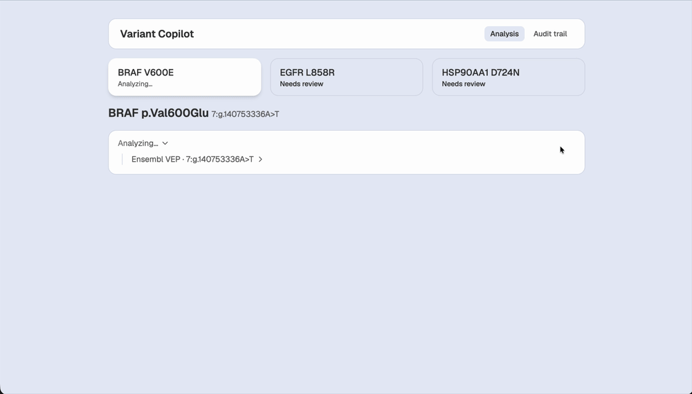

# Variant Copilot

A Python agent that annotates a tumor variant from Ensembl and PubMed, and a React interface where an expert watches the agent work, then accepts, corrects or rejects its sourced conclusion.



## Why

Interpreting a tumor variant takes hours of expert time, mostly spent reading literature. An AI assistant is only worth it if every claim it makes can be checked, if it says so when evidence is missing, and if a human signs off on every conclusion. Variant Copilot is a small prototype built around those three requirements:

- **Sourced evidence:** every claim links to the Ensembl page or PubMed article it comes from, and the code rejects any cited URL that no tool returned.
- **Honest uncertainty:** the agent can answer _VUS_ or _insufficient evidence_ instead of guessing.
- **Human in the loop:** an expert accepts, corrects or rejects each proposal, and every decision goes to an append-only audit trail.

## The three variants

All three are linked to **Hsp90**, the molecular chaperone I worked on in Didier Picard's lab in Geneva ([PLOS ONE, 2011](https://doi.org/10.1371/journal.pone.0026044); [PPiMapBuilder](https://github.com/PPiMapBuilder)).

| Variant        | Why                                                                                        | Expected result                                         |
| -------------- | ------------------------------------------------------------------------------------------ | ------------------------------------------------------- |
| BRAF V600E     | The best-known melanoma driver, an Hsp90 client                                            | Oncogenic                                               |
| EGFR L858R     | A lung cancer driver whose mutant depends on Hsp90                                         | Oncogenic                                               |
| HSP90AA1 D724N | Hsp90α itself, 4 residues before the MEEVD motif; rare in gnomAD, seen in COSMIC, no paper | VUS: the agent must not conclude from predictions alone |

The third one is the interesting case: SIFT and PolyPhen call it damaging, PubMed has nothing, and the agent asks for expert review instead of guessing.

## Architecture

```
Browser (React + Vite)                Backend (FastAPI)                    External
┌──────────────────────┐   /api   ┌──────────────────────────────┐
│ variant list          │ ───────▶ │ routes (main.py)              │
│ live agent trace ◀─SSE─────────  │   └─ agent loop (agent.py) ───┼──▶ OpenAI (LLM)
│ annotation card       │         │        ├─ Ensembl VEP tool ───┼──▶ rest.ensembl.org
│ expert review, audit  │         │        └─ PubMed tool ────────┼──▶ NCBI E-utilities
└──────────────────────┘          │ data/ http_cache · runs ·    │
                                   │       reviews.jsonl          │
                                   └──────────────────────────────┘
```

The browser only talks to the API (through the Vite proxy). Only the agent calls the LLM and the public databases. Every expert decision goes to a log that is never edited.

## Design choices

- **A hand-written agent loop, no framework.** `run_agent` in [`agent.py`](backend/app/agent.py) is about 100 lines: every step is visible and auditable.
- **Structured output through a tool.** The agent must finish by calling `submit_annotation`, whose schema is generated from the Pydantic model. The answer is always valid JSON, and an invalid one is sent back to the model, which corrects itself.
- **URL check against hallucinations.** A cited URL that no tool returned can only be invented: it is refused.
- **Deterministic code wherever a rule exists.** The LLM only writes the searches, reads the abstracts and weighs the evidence. Everything else is plain code, including the rule that forces expert review for a VUS. See [docs/agent-vs-code.md](docs/agent-vs-code.md).
- **Tagged PubMed queries.** Without `[tiab]` tags, PubMed silently drops unknown words: `HSP90AA1 D724N` returns 1,500 unrelated articles, the tagged query returns 0. The tool also returns PubMed's own translation of each query.
- **Small, clean tool results.** Each tool returns ~10 fields with their source, never raw JSON: the model reasons better and costs less.
- **An append-only audit trail.** `data/reviews.jsonl` has one line per decision. A correction is a new line, nothing is deleted, and the AI proposal is copied from the server, never sent by the browser.
- **Saved runs and replay.** Each successful analysis is saved with all its events. The page shows it at load time and can replay it with its original timing, at no cost and without network.
- **Live streaming.** The trace is pushed with Server-Sent Events. If the browser disconnects, the agent stops before its next LLM call.

## Run it

Requirements: [uv](https://docs.astral.sh/uv/) and Node with Corepack (Yarn 4). A dev container with an egress firewall is included in [`.devcontainer/`](../../.devcontainer).

```bash
cp apps/variant-copilot/backend/.env.example apps/variant-copilot/backend/.env   # then set OPENAI_API_KEY and LLM_MODEL
cd apps/variant-copilot/backend && uv run uvicorn app.main:app --port 8000
yarn install                       # from the repo root, in a second terminal
yarn workspace frontend dev        # then open http://localhost:5173
```

The saved runs in `backend/data/runs/` are shown and replayed **without an OpenAI key**: only _Analyze_ calls the LLM (about one cent per run).

Other entry points, from `backend/`:

```bash
uv run python -m app.cli braf-v600e               # the agent in the terminal
uv run python scripts/check_tools.py              # the two tools alone, no LLM
OFFLINE=1 uv run python scripts/check_tools.py    # same, from the HTTP cache only
uv run pytest                                     # the tests, no network, no key
```

## Tests

Two promises, each tested without network or API key:

- **Anti-hallucination** ([`test_anti_hallucination.py`](backend/tests/test_anti_hallucination.py)): an annotation citing a URL that no tool returned is refused. With a fake LLM, the full loop rejects an invented PMID, sends the refusal back to the model, and accepts its correction.
- **Audit** ([`test_audit.py`](backend/tests/test_audit.py)): a rejection or correction without a comment is refused, by the model and by the API, and nothing reaches the audit trail. A revision is a new line, and the history is kept.

## Limitations and next steps

- Three hard-coded variants: no VCF parsing.
- PubMed only: no expert-curated knowledge base such as ClinVar or OncoKB.
- Oncogenicity only: no AMP/ASCO/CAP actionability tiers.
- Claims are checked for their URL, not their content: a claim could misquote a real article.
- OpenAI only: patient data would need an EU-hosted or local model. The LLM client lives in one module ([`llm.py`](backend/app/llm.py)) to make that swap easy.
- No evaluation yet: the next step is a set of variants already classified by experts, measuring agreement, stability across runs, and above all severe errors (an oncogenic variant called benign).

## Documentation

- [docs/bio-primer.md](docs/bio-primer.md): the bioinformatics behind the data (HGVS, transcripts, VEP consequences, gnomAD, COSMIC, oncogenicity classes). [Version française](docs/bio-primer.fr.md).
- [docs/agent-vs-code.md](docs/agent-vs-code.md): what the LLM does, what plain code does, and why. [Version française](docs/agent-vs-code.fr.md).

## Disclaimer

Educational prototype using public data only. Not a medical device, not for clinical use.
